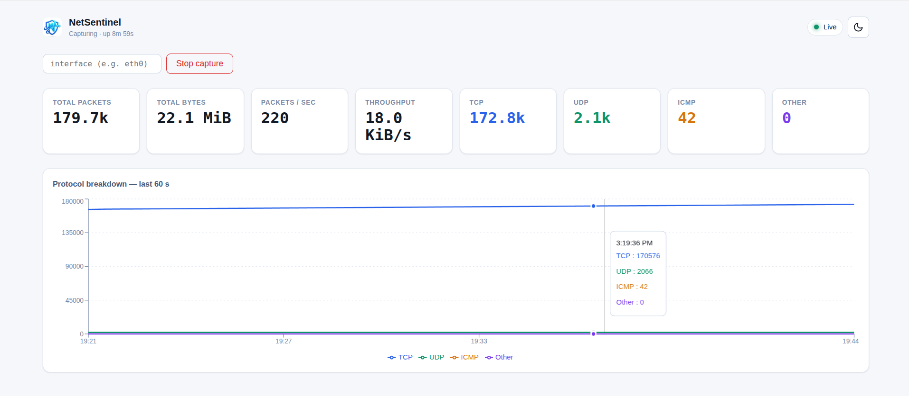
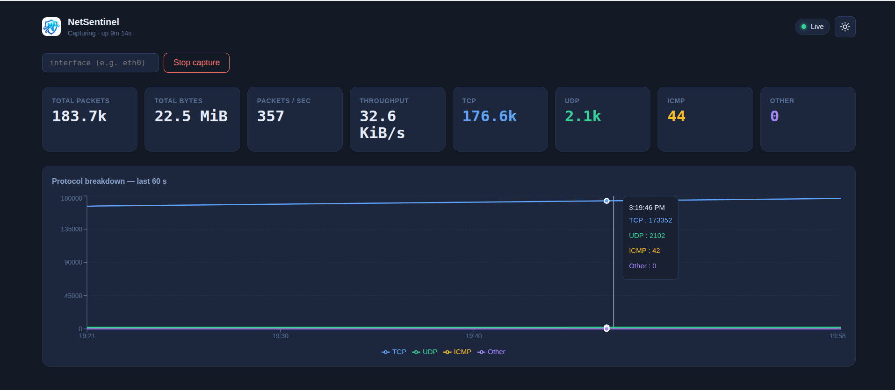

# 🛡️ NetSentinel

> 💡 **A full-stack network traffic monitor that answers one question in real time: *What is actually hitting this machine right now?***

NetSentinel is a **four-layer traffic analysis platform** built from first principles: a raw-socket **C packet engine**, bridged into Node.js via **N-API**, exposed over **REST + WebSocket**, and rendered in a **React dashboard** that updates twice a second.



<p align="center"><em>Light theme — live capture on <code>lo</code></em></p>



<p align="center"><em>Dark theme — same data, different palette</em></p>


---

## ✨ Features

### 📡 Packet Capture
- **`AF_PACKET` + `SOCK_RAW`** on a specific interface — real `struct ethhdr`, not the synthetic `LINUX_SLL2` from `tcpdump -i any`
- **Auto-detects the default interface** (first non-loopback NIC with an IPv4 address)
- **Promiscuous mode** attempted but not required — graceful warning on virtual interfaces (WSL, most VMs) that don't support it
- **250 ms `SO_RCVTIMEO`** so the capture loop is interruptible without a signal-kick pipe
- **4 MiB `SO_RCVBUF`** to survive bursts

### 🧬 IPv4 Protocol Parsing
- **Ethernet → IPv4 → TCP / UDP / ICMP** headers parsed with real kernel structs (`<netinet/ip.h>`, `<netinet/tcp.h>`, `<netinet/udp.h>`)
- **IPv4 options supported** (IHL > 5) — L4 offset is computed from the IHL field, not a hardcoded 20
- **Alignment-safe** — every header is `memcpy`'d into an aligned stack local; the parser has zero unaligned-pointer UB on any architecture
- **Truncation-checked** — every read is bounds-checked against the captured length; a cut-off frame returns `-1` rather than reading past the buffer

### 📊 Thread-Safe Counter Engine
- **Mutex-guarded global stats struct** — `stats_record_*` and `stats_snapshot` are safe to call from any thread
- **Per-protocol bucketing** — TCP / UDP / ICMP / other, plus IPv4 / non-IPv4 split
- **Snapshot is a copy** — mutating the live counters after a `stats_snapshot()` never changes the snapshot
- **`stats_reset()`** — atomic zeroing, used by the tests

### 🔌 Node-API Bridge
- **Five exported functions** — `startCapture(iface?) → Promise<string>`, `stopCapture() → Promise<void>`, `onStats(cb, ms?)`, `getStats() → object`, `isRunning() → boolean`
- **`AsyncWorker` for control-plane** — `startCapture` / `stopCapture` never block the JS event loop
- **`ThreadSafeFunction` for live push** — a dedicated C++ ticker thread calls JS every interval, safe under Node's env teardown
- **Three-mutex discipline** — `g_capture_mu`, `g_lifecycle_mu`, `g_tsfn_mu`, each guarding a distinct resource; documented in `addon/README.md`
- **Handles `process.exit` without `stopCapture`** — env cleanup hook joins the ticker and destroys capture, no `SIGABRT`

### 🌐 Express + WebSocket Server
- **Express 5** with **Promise-aware route handlers** — `async` route throws become 500s without `next(err)`
- **Bearer auth on `/api/stats`** — `crypto.timingSafeEqual` comparison, prevents timing side-channels
- **WS auth via query string** — `?token=...` because browsers cannot set custom headers on the WebSocket handshake (spec limitation, not a design choice)
- **One interval, fan out** — a single `setInterval` per server, not one per client; rates computed server-side from consecutive `getStats()` calls
- **Bounded backpressure** — if a client falls behind, its socket buffer grows but the server never blocks
- **Graceful shutdown** — WSS drain → capture stop → HTTP close, with a 5 s force-exit safety net
- **Static serving** — in production, Express serves the built dashboard from `dashboard/dist/`; one process, one port

### 🎨 React Dashboard
- **Live update at 2 Hz** — WebSocket push, no polling
- **Server-computed rates** — `pps` and `bps` come from the server, so a throttled tab can't show 0-then-burst
- **60-second rolling chart** — 120-point ring, protocol lines color-coded for color-blind accessibility
- **Backpressure guard** — drops incoming snapshots when `bufferedAmount` exceeds 1 MiB
- **Auto-reconnect** — exponential backoff capped at 8 s, prevents thundering-herd on restart
- **Light theme default**, dark theme persists via `localStorage`
- **Mobile-first layout** — reflows at 375 / 768 / 1440

### 🐳 Production Deployment
- **Multi-stage Dockerfile** — addon built with `build-essential`, dashboard built with Vite, server compiled with `tsc`, all collapsed into one ~200 MiB runtime image
- **Non-root user with `CAP_NET_RAW` only** — no `USER root`, no `privileged: true`
- **Read-only root filesystem** — `read_only: true` + `tmpfs: [/tmp]`; the container can read packets but can't write to disk
- **`dumb-init` as PID 1** — so `docker stop` reaches Node and the graceful shutdown actually runs
- **Apache reverse proxy with WS tunneling** — `mod_proxy_wstunnel`, not `mod_proxy_http`; the URL scheme in `ProxyPass` is `ws://`, which is what activates it
- **nftables reference ruleset** — with a README explaining why `AF_PACKET` sees packets that `nft` drops

---

## 🛠️ Tech Stack

| Layer | Technology |
|-------|-----------|
| **Packet capture** | C11, `AF_PACKET` / `SOCK_RAW`, `pthread`, no external libs |
| **Node bridge** | C++17, `node-addon-api` 8, `Napi::AsyncWorker`, `Napi::ThreadSafeFunction` |
| **HTTP server** | Node 22, Express 5, `ws` 8 |
| **Frontend** | React 18, Vite 6, Recharts 2, hand-written CSS |
| **Build** | `node-gyp`, GNU `make`, `tsc`, Vite |
| **Containers** | Docker, Docker Compose |
| **Proxy** | Apache 2.4 with `mod_proxy_wstunnel` (reference config) |
| **Firewall** | nftables (reference config) |
| **Testing** | `node:test` + `node:assert` (addon/server), Vitest + jsdom (dashboard), custom C `main()` (engine) |

---

## 🏗️ Architecture

NetSentinel is a **four-layer pipeline** with a strict one-way data flow: kernel → C → C++ → Node → browser. Each layer has a documented contract and a test suite that exercises it in isolation.

### System Architecture

```
┌───────────────────────────────────────────────────────────────┐
│                         Linux kernel                          │
│                                                               │
│   NIC ──► AF_PACKET socket (SOCK_RAW, bound to one iface)     │
│                                                               │
└──────────────┬────────────────────────────────────────────────┘
               │  recvfrom() — 250 ms timeout
               ▼
     ┌───────────────────┐
     │   C engine        │   engine/src/
     │   ─────────────   │
     │   capture.c       │   pthread recv loop, promisc, 4 MiB buf
     │   parser.c        │   Ethernet → IPv4 → L4, alignment-safe
     │   stats.c         │   mutex-guarded counters
     │   util.c          │   interface auto-detection
     └─────────┬─────────┘
               │  stats_snapshot() — memcpy under mutex
               ▼
     ┌───────────────────┐
     │   N-API bridge    │   addon/src/  (C++17, node-addon-api)
     │   ─────────────   │
     │   AsyncWorker     │   startCapture / stopCapture (Promise)
     │   TSFN            │   onStats — ticker thread → JS callback
     │   getStats()      │   synchronous, returns a snapshot object
     │   EnvCleanup      │   joins ticker + destroys capture at exit
     └─────────┬─────────┘
               │  require('build/Release/netsentinel_addon.node')
               ▼
     ┌───────────────────┐
     │   Node.js server  │   server/src/  (TypeScript, Express 5)
     │   ─────────────   │
     │   /api/health     │   public liveness (no token)
     │   /api/stats      │   bearer auth; snapshot + capture control
     │   /ws             │   one interval, fan out to all clients
     │   /               │   serves built dashboard (production only)
     └─────────┬─────────┘
               │  JSON over WebSocket — 500 ms cadence
               ▼
     ┌───────────────────┐
     │   React dashboard │   dashboard/src/  (Vite, React 18, TS)
     │   ─────────────   │
     │   StatTile × 8    │   cumulative counters + derived rates
     │   LiveChart       │   last 60 s protocol breakdown
     │   CaptureControls │   start / stop from the browser
     │   ThemeToggle     │   light default, dark persisted
     └───────────────────┘
```

### Data Flow — Packet Ingest

```
[ NIC receives a frame ]
        │
        ▼
[ kernel AF_PACKET filter ]
        │
        ▼
[ capture_loop() pthread ]   ──── capture.c
        │  recvfrom(fd, buf, SNAP_LEN)
        ▼
[ on_packet_cb() ]           ──── capture_manager.cpp
        │
        ├──▶ parse_ethernet_ipv4()   ──── parser.c
        │        │
        │        ├── memcpy(struct ethhdr)   ← alignment-safe
        │        ├── memcpy(struct iphdr)    ← alignment-safe
        │        └── memcpy(struct tcphdr / udphdr)
        │        │
        │        └── returns parsed_packet_t or -1
        │
        ├── success:  stats_record_ipv4(caplen, proto, dst_port)
        └── failure:  stats_record_other(caplen)
        │
        ▼
[ g_stats under pthread_mutex ]  ──── stats.c
```

### Data Flow — Live Update

```
[ server-side setInterval — 500 ms ]   ──── server/src/ws/broadcaster.ts
        │
        ▼
[ addon.getStats() ]  ──── server/src/capture.ts
        │  returns a snapshot object (mutex copy)
        ▼
[ compute pps, bps from previous snapshot ]
        │  dt = now - prevTime
        │  pps = (snap.total_packets - prev.total_packets) / dt
        │  bps = (snap.total_bytes   - prev.total_bytes)   / dt
        ▼
[ serialize { type, data } once ]
        │
        ├──▶ ws #1  ─┐
        ├──▶ ws #2   │
        └──▶ ws #N  ─┘    one payload, N sockets — O(N), not O(N²)
                        │
                        ▼
        [ browser useStats() hook ]  ──── dashboard/src/hooks/useStats.ts
                        │
                        ├──▶ 120-point ring buffer
                        ├──▶ setLatest() for tiles
                        └──▶ setPoints() for chart
```

### Data Flow — Capture Control

```
[ POST /api/stats/capture/start { interface: "lo" } ]
        │
        ▼
[ requireToken middleware ]  ──── server/src/middleware/auth.ts
        │  timingSafeEqual(bearer, config.apiToken)
        ▼
[ statsRouter.post handler ]  ──── server/src/routes/stats.ts
        │  if isRunning → 409
        │  else → await addon.startCapture(iface)
        ▼
[ StartWorker::Execute ]  ──── addon/src/addon.cpp
        │  runs on libuv worker thread
        ▼
[ capture_manager::start() ]  ──── addon/src/capture_manager.cpp
        │  lock g_capture_mu
        │  capture_create() → capture_start() → store ctx
        ▼
[ OnOK → resolve Promise with iface name ]
        │
        ▼
[ res.status(201).json({ interface: "lo" }) ]
```

---

## 📁 Project Structure

```
NetSentinel/
├── Dockerfile                              ← 4-stage build (addon → dashboard → server → runtime)
├── docker-compose.yml                      ← CAP_NET_RAW, read-only rootfs, healthcheck
├── .dockerignore
├── binding.gyp                             ← node-gyp build (mixed C/C++)
├── Makefile                                ← C engine build + C test runner
├── package.json                            ← root deps (node-addon-api, node-gyp)
├── README.md                               ← this file
│
├── engine/                                 ← C packet capture engine
│   ├── src/
│   │   ├── capture.c/h                     ← AF_PACKET socket, pthread recv loop
│   │   ├── parser.c/h                      ← Ethernet/IPv4/L4 header parsing
│   │   ├── stats.c/h                       ← mutex-guarded counters
│   │   └── util.c/h                        ← interface auto-detection
│   ├── cli/
│   │   └── main.c                          ← Phase-1 standalone CLI binary
│   └── tests/
│       ├── test_parser.c                   ← 11 cases / 29 assertions
│       └── test_stats.c                    ←  8 cases / 36 assertions
│
├── addon/                                  ← Node-API bridge
│   ├── src/
│   │   ├── addon.cpp                       ← NAPI entry + export table
│   │   ├── capture_manager.cpp/h           ← capture_ctx_t lifecycle
│   │   ├── stats_publisher.cpp/h           ← ticker thread + TSFN
│   │   └── snapshot_to_object.h            ← single C→JS conversion
│   ├── tests/
│   │   ├── test_api.js                     ← 8 tests — API contract
│   │   ├── test_concurrency.js             ← 5 tests — Promise.all races
│   │   ├── test_swap.js                    ← 1 test  — onStats replacement
│   │   ├── test_cycle.js                   ← 1 test  — ticker restart
│   │   ├── test_exit.js                    ← 1 test  — process.exit teardown
│   │   └── test_addon.js                   ← interactive demo
│   ├── README.md                           ← ⚠️ threading contract
│   └── package.json
│
├── server/                                 ← Express + ws server
│   ├── src/
│   │   ├── index.ts                        ← HTTP/WS bootstrap, shutdown, static
│   │   ├── config.ts                       ← env parsing
│   │   ├── capture.ts                      ← typed addon wrapper
│   │   ├── middleware/
│   │   │   ├── auth.ts                     ← bearer + timingSafeEqual
│   │   │   └── security.ts                 ← CSP, HSTS, X-Frame-Options
│   │   ├── routes/
│   │   │   ├── health.ts                   ← /api/health (public)
│   │   │   └── stats.ts                    ← /api/stats + capture control
│   │   └── ws/
│   │       └── broadcaster.ts              ← single interval, fan-out
│   ├── tests/
│   │   ├── test_http.js                    ← 13 assertions
│   │   ├── test_security.js                ←  6 assertions
│   │   └── test_ws.js                      ←  9 assertions
│   ├── tsconfig.json
│   └── package.json
│
├── dashboard/                              ← React dashboard
│   ├── src/
│   │   ├── App.tsx                         ← composition + grid
│   │   ├── main.tsx
│   │   ├── api/
│   │   │   ├── client.ts                   ← fetch + WS URL builder
│   │   │   └── types.ts                    ← shared shapes with server
│   │   ├── components/
│   │   │   ├── Header.tsx
│   │   │   ├── StatTile.tsx
│   │   │   ├── LiveChart.tsx               ← Recharts, animations off
│   │   │   ├── CaptureControls.tsx
│   │   │   ├── ConnectionBadge.tsx         ← role="status", aria-live
│   │   │   ├── ThemeToggle.tsx
│   │   │   └── ErrorBanner.tsx
│   │   ├── hooks/
│   │   │   ├── useStats.ts                 ← WS connect, backoff, ring
│   │   │   ├── useHealth.ts                ← 5 s poll
│   │   │   ├── useCaptureControl.ts
│   │   │   └── useTheme.ts
│   │   └── styles/
│   │       ├── globals.css
│   │       └── variables.css               ← light + dark via data-theme
│   ├── vite.config.ts
│   ├── tsconfig.json
│   └── package.json
│
├── deploy/
│   ├── apache/
│   │   └── netsentinel.conf                ← WS tunneling + TLS termination
│   └── firewall/
│       ├── nftables.conf                   ← reference ruleset
│       └── README.md                       ← why AF_PACKET sees dropped traffic
│
├── docs/
│   └── screenshot-light.png
│
└── test/
    └── run.sh                              ← end-to-end harness
```

---

## 🚀 Quick Start

### Prerequisites

| Tool | Version | Notes |
|------|---------|-------|
| **Node.js** | 22.x | Addon is built against this exact ABI |
| **gcc / make** | any recent | For the C engine |
| **Python 3** | 3.10+ | `node-gyp`'s build dependency |
| **Docker** | latest | Recommended path |
| **Apache 2.4** | optional | Production reverse proxy |

### 🐳 Docker (recommended for a complete demo)

```bash
git clone https://github.com/<you>/NetSentinel.git
cd NetSentinel

export API_TOKEN="$(openssl rand -hex 32)"
docker compose build
docker compose up -d

# Wait for the healthcheck to pass
docker compose ps     # STATUS should show "healthy" within ~30 s

open http://localhost:3000
```

`docker compose up` runs a four-stage build: addon compiled against Node 22 with `build-essential`, dashboard compiled with Vite, server compiled with `tsc`, all collapsed into one runtime image. The container runs as an **unprivileged user with only `CAP_NET_RAW` and `CAP_NET_ADMIN`** — no `privileged: true`, no `USER root`.

### 💻 Local (dev)

```bash
# 1. Build the C engine + native addon
npx node-gyp rebuild

# 2. Build and run the server
cd server
npm install
npm run build
sudo API_TOKEN=dev-token-change-me CAPTURE_INTERFACE=lo PORT=3000 npm start
# → http://localhost:3000/api/health

# 3. Run the dashboard in dev mode (separate terminal)
cd dashboard
npm install
echo 'VITE_API_TOKEN=dev-token-change-me' > .env.local
npm run dev
# → http://localhost:5173
```

`sudo` is required because `AF_PACKET` needs `CAP_NET_RAW`. If you'd rather not prefix every run with `sudo`:

```bash
sudo setcap cap_net_raw,cap_net_admin=eip "$(which node)"
```

### 🖥️ Standalone C engine (no Node)

```bash
make                # builds engine/build/netsentinel
sudo ./engine/build/netsentinel                    # auto-detect interface
sudo ./engine/build/netsentinel -i eth0            # explicit interface
sudo ./engine/build/netsentinel -i eth0 -n 500     # print every 500 ms
```

This is the Phase-1 binary — same capture loop, same parser, same stats, just a `printf` table instead of a React UI. Useful for isolating whether a bug is in the C engine or in the layers above.

---

## 🎮 Usage

| Action | Where |
|---|---|
| **Start capture** | Dashboard → **Start capture** button, or `POST /api/stats/capture/start` |
| **Stop capture** | Dashboard → **Stop capture** button, or `POST /api/stats/capture/stop` |
| **Switch interface** | Dashboard → type into interface field, click **Start capture** |
| **Toggle theme** | Top-right moon/sun icon |
| **View stats** | `curl -H "Authorization: Bearer $API_TOKEN" http://localhost:3000/api/stats` |
| **Liveness probe** | `curl http://localhost:3000/api/health` (no token needed) |

### To see the charts move

While the dashboard is open:

```bash
# Generate TCP traffic
curl -s https://example.com > /dev/null

# Generate ICMP traffic
ping -c 5 127.0.0.1

# Generate UDP traffic (requires dig or nslookup)
dig @8.8.8.8 example.com
```

The **TCP** counter climbs during the curl, **ICMP** jumps by 10 (request + reply, both visible on `lo`), and the rolling chart shows the spike over the last 60 seconds. `Other` stays at 0 on `lo` — loopback only carries IPv4, and only TCP/UDP/ICMP at that. To see `Other` climb, capture on a real interface and generate ARP traffic (`arp -a` a few times).

---

## 🧪 Testing

NetSentinel ships with **121 passing tests** across four languages.

| Layer | Command | Count |
|---|---|---|
| **Engine (C)** | `make test` | 65 assertions |
| **Addon (JS)** | `cd addon && npm test` | 14 tests |
| **Server (JS)** | `cd server && npm test` | 28 tests |
| **Dashboard (TS)** | `cd dashboard && npm test` | 14 tests |

Full stack:

```bash
bash test/run.sh
```

The harness starts its own server with `CAPTURE_INTERFACE=lo` and `API_TOKEN=dev-token-change-me`, runs every suite, and tears everything down.

### Test breakdown

| File | What it proves |
|---|---|
| `engine/tests/test_parser.c` | 11 cases / 29 assertions — TCP/UDP/ICMP parsing, IHL options (shifted L4 offset), truncation rejection, version/ihl rejection, port boundaries (0 and 65535), byte order |
| `engine/tests/test_stats.c` | 8 cases / 36 assertions — per-protocol isolation (TCP record doesn't touch UDP), non-IPv4 independence, accumulation, snapshot-is-a-copy, reset |
| `addon/tests/test_api.js` | 8 tests — exports, snapshot shape, invalid interface rejection, full lifecycle |
| `addon/tests/test_concurrency.js` | 5 tests — `Promise.all([start, start])` → exactly one wins, `Promise.all([stop, stop])` → one wins, 20-cycle start/stop with no leak, `onStats` during `startCapture` |
| `addon/tests/test_swap.js` | `onStats(cb2)` replaces `cb1` — `cb1` stops firing, `cb2` starts |
| `addon/tests/test_cycle.js` | Ticker restarts after `stopCapture → startCapture` even though `onStats` was called once |
| `addon/tests/test_exit.js` | `process.exit(0)` without `stopCapture` — no `SIGABRT` from the ticker thread |
| `server/tests/test_http.js` | 13 assertions — response shapes, monotonicity invariant, 4-state capture machine, malformed JSON, 404 for unknown paths |
| `server/tests/test_security.js` | 6 assertions — bearer required, wrong token rejected, health is public, security headers, dev CORS |
| `server/tests/test_ws.js` | 9 assertions — cadence, monotonicity, concurrent clients, bad-token rejection (1008), abrupt disconnect doesn't crash server |
| `dashboard/src/hooks/useStats.test.tsx` | Connect state machine, snapshot parsing, 120-point cap, backpressure drop, reconnect state |
| `dashboard/src/hooks/useTheme.test.tsx` | Default light, localStorage round-trip, invalid-value fallback |
| `dashboard/src/api/client.test.ts` | `ws://` vs `wss://`, token inclusion/omission |

---

## 🏛️ Engineering Decisions

### Why `AF_PACKET` on a bound interface, not `any`

`tcpdump -i any` and the kernel's `any` pseudo-interface both use **`LINUX_SLL2`** — a synthetic link-layer header that lacks `struct ethhdr`. This is why tcpdump warns *"any doesn't support promiscuous mode"*: there's no real NIC to enable it on.

NetSentinel binds to one real interface (auto-detected or `-i <iface>`), so `parser.c` sees real Ethernet frames with a 14-byte `struct ethhdr` at offset 0. This is why `capture.c` calls `if_nametoindex()` and uses `sockaddr_ll` — an **interface-bound** socket, not `any`.

### Why `memcpy` instead of pointer casts

`buf + sizeof(struct ethhdr)` is offset 14. Casting that to `const struct iphdr *` — a struct that contains `uint32_t` fields — is **undefined behavior** because 14 is not a multiple of 4. On x86 the compiler silently emits unaligned loads; on ARM/MIPS it's a `SIGBUS`.

`parser.c` `memcpy`s each header into an aligned stack local. This compiles to a **single `mov`** on x86 (the same instruction the cast would produce) and is defined behavior on every architecture.

This bug passed `-Wall -Wextra -Wconversion -Wshadow`. It was only caught by `-fsanitize=undefined`. The test suite covers IHL = 6 specifically because that's where the offset shift makes the misalignment worse.

### Why the server uses `getStats()` polling, not `onStats`

The addon exposes a `ThreadSafeFunction`-backed `onStats(cb, intervalMs)` — a ticker thread calls JS every interval. The server does **not** use it. Reasons:

1. **`ThreadSafeFunction` has exactly one slot.** If the server registered a callback, any future consumer (an alerting engine, per-interface fanout) would fight for it. Tests would still pass — they'd just be racing.
2. **`getStats()` is a mutex-guarded `memcpy` of a 64-byte struct.** At 500 ms cadence, that's free.
3. **The broadcaster is the only place rates are computed**, which means `pps` and `bps` reflect true wall-clock deltas on the server, not client-local time. A backgrounded browser tab cannot corrupt them.

The TSFN path is fully implemented and tested. It's just not on the server's hot path. This is a deliberate API design, not an oversight.

### Why one interval, not one per client

`StatsBroadcaster` has **one** `setInterval`. On each tick it calls `getStats()` **once**, computes rates from the previous tick, serializes the payload **once**, and writes the same JSON to every open socket.

The obvious wrong design — a timer per client — scales as **O(N²)** network calls and makes rate computation **impossible** (each client sees a different previous value, so the rates diverge). It's also how you get a server that melts under load while under-reporting the exact load that's melting it.

### Why bearer auth on both transports

`/api/stats` requires `Authorization: Bearer <token>`, compared with `crypto.timingSafeEqual` to prevent character-by-character brute force via latency measurement.

`/ws` requires `?token=<token>` because browsers **cannot** set custom headers on the WebSocket handshake — this is a spec limitation, not a design choice. The token is validated **before** the WS `101 Switching Protocols` response, so an unauthenticated client never gets a socket at all (close code `1008`, policy violation).

### Why rates are computed on the server

Browsers throttle `setTimeout` and `setInterval` in background tabs to once per minute. A client that derived `pps` from `Date.now()` deltas would show **zero packets/s for 29 minutes**, then **3,500 packets/s for 2 seconds** when foregrounded. That's not a rate — that's an artifact of the browser's timer throttling.

Computing rates on the server means the *only* wall-clock that matters is the server's, and it's monotonic per interval. A throttled client sees a delayed burst of real snapshots; the numbers are correct, just delayed.

### Why backoff caps at 8 s

When the server restarts, every connected client reconnects immediately. At 100 clients, that's 100 simultaneous WS handshakes hitting the server in the first 100 ms of availability. Exponential backoff — 500 ms, 1 s, 2 s, 4 s, capped at 8 s — spreads the reconnect load over tens of seconds. The exact threshold (8 s) is arbitrary; what matters is that it's bounded.

### Why `<meta name="color-scheme">` and `data-theme` on `<html>`

Two different APIs for two different concerns:

- **`data-theme="dark"`** on `<html>` is what CSS reads via `:root[data-theme="dark"] { --bg-base: ... }`. It changes the app's colors.
- **`<meta name="color-scheme" content="light dark">`** tells the browser to render **native UI controls** (scrollbars, form inputs, autofill backgrounds) in the correct color scheme. Without it, a dark-themed app shows a bright-white `<input>` background.

Both are necessary. The `data-theme` attribute handles the app's own CSS; the meta tag handles the browser's.

---

## 🔒 Security Notes

- **Bearer token comparison uses `crypto.timingSafeEqual`.** Length-mismatch comparison returns `false` immediately (safe), and equal-length comparison takes constant time regardless of which byte differs — no character-by-character brute force via latency.
- **The token is required in production.** `NODE_ENV=production` without `API_TOKEN` set causes a hard startup failure (`process.exit(1)`), not a warning.
- **WS tokens go in the query string, not headers.** This is a WebSocket spec limitation. The token is short-lived in practice, but it appears in the URL — which means it may end up in Apache access logs. If you deploy with Apache, redact the query string in the log format, or use a short-lived ticket endpoint (Phase 6).
- **CSP is hand-written, not helmet defaults.** Every directive is explicit so you can explain exactly what you set and why `'unsafe-inline'` for styles is dev-only. In production behind a Vite build, tighten this to your hashed asset domain.
- **CORS is dev-only.** In production, Express serves the dashboard from the same origin, so no CORS is needed — and none is enabled.
- **Container runs as non-root with only `CAP_NET_RAW` + `CAP_NET_ADMIN`.** `read_only: true` on the root filesystem, `tmpfs: [/tmp]`, `no-new-privileges:true`. The process can read packets, but cannot write to disk or escalate privileges.
- **`AF_PACKET` sees every frame the NIC delivers — including ones the firewall drops.** This is a *feature*, not a leak: it's why NetSentinel shows you a spike in port-23 probes even when the firewall is doing its job. See `deploy/firewall/README.md` for the full explanation.

---

## 🤖 AI-Assisted Development

AI tools (Claude, Gemini) were used throughout development to accelerate scaffolding and support learning. Effective uses included:

- **Architecture design** — the four-layer pipeline, the decision to keep the addon split into `capture_manager` / `stats_publisher`, and the decision to compute rates server-side were all discussed and refined before code was written.
- **Threading review** — the three-mutex discipline (`g_capture_mu`, `g_lifecycle_mu`, `g_tsfn_mu`) was iteratively refined through a series of `Promise.all` race-condition tests that surfaced real bugs (`std::terminate` from the ticker destructor, TSFN refcount underflow causing `SIGABRT`).
- **Bug diagnosis** — `PACKET_MR_UNPROMISC` doesn't exist (the correct API is `PACKET_DROP_MEMBERSHIP` with `mr_type = PACKET_MR_PROMISC`); the unaligned-pointer UB in `parser.c` was diagnosed from a `-fsanitize=undefined` trace; `__dirname` is undefined in `NodeNext`-mode ESM (the replacement is `import.meta.dirname`).
- **Apache config** — the `mod_proxy_wstunnel` vs `mod_proxy_http` distinction, and the "`ProxyPass` matches the first rule that matches" ordering gotcha, were both AI-surfaced.
- **Documentation** — this README, `addon/README.md`, and `deploy/firewall/README.md` were drafted with AI assistance and reviewed for accuracy.

---

## 🖥️ Compatibility

| | |
|---|---|
| ✅ **Supported** | Ubuntu 22.04 / 24.04, Debian 12, Docker on any Linux |
| ⚠️ **Not tested** | macOS (AF_PACKET is Linux-only), Windows (WSL2 works with `lo`) |
| 🟣 **Runtime** | Node.js 22.x (addon is built against this exact ABI; rebuild after any Node upgrade) |

### Wi-Fi limitation

On a Wi-Fi interface in **managed mode**, the driver delivers only your own traffic + management frames to `AF_PACKET`. Pings to `8.8.8.8` through a Wi-Fi card show up in `icmp_packets`; other stations' unicast traffic does not. The reason is that `mac80211` filters most unicast frames before they reach any userspace socket.

- To test **real** traffic: use an **Ethernet** interface, or **`lo`** for a full working demo.
- To capture Wi-Fi traffic: `iw dev <if> set type monitor` — but this changes the frame format to **radiotap + 802.11**, and requires a radiotap parser (out of scope; parser.c targets Ethernet only).

`non_ipv4_packets` will climb on Wi-Fi in managed mode because the driver exposes 802.11 management frames — they're correctly classified as `non-IPv4` because they don't have an Ethernet+IPv4 payload.

---

## 🐛 Troubleshooting

### `npx node-gyp rebuild` fails with "binding.gyp not found"

You're running it from a subdirectory. `node-gyp` looks for `binding.gyp` in the **current directory**, and it only lives at the repo root.

```bash
cd ~/Storage/Projects/NetSentinel
npx node-gyp rebuild
```

### Addon load fails with `NODE_MODULE_VERSION` mismatch

You upgraded Node without rebuilding the addon. `node-gyp` compiles against the exact ABI of the Node binary that ran it. Rebuild:

```bash
npx node-gyp rebuild
```

Then restart the server and any dashboard dev process.

### Dashboard shows "Connecting" forever

Three candidates, in order of likelihood:

1. **`VITE_API_TOKEN` doesn't match `API_TOKEN` on the server.** Check `dashboard/.env.local` and the `API_TOKEN=...` you passed to `npm start`. If they differ, the WS handshake is rejected with `1008`.
2. **The server isn't running.** `curl http://localhost:3000/api/health` should return `{"status":"ok"}`.
3. **The Vite proxy isn't configured.** `vite.config.ts` must have `'/ws': { target: 'ws://localhost:3000', ws: true }`. Missing `ws: true` is the classic gotcha — Vite tries to proxy the upgrade as an HTTP request and the browser gets a 400.

### `npm test` fails in `server/` with `ECONNREFUSED`

`server/tests/*.js` require a **running server**. Start it first:

```bash
sudo API_TOKEN=dev-token-change-me CAPTURE_INTERFACE=lo PORT=3000 node server/dist/index.js
```

Then in another terminal:

```bash
cd server
npm test
```

Alternatively, `bash test/run.sh` from the repo root spawns its own server, runs every suite, and shuts everything down.

### `Capturing` badge is green but every counter is zero

You're capturing on an interface that sees no traffic. On Wi-Fi in managed mode this is expected — the driver filters most frames. Switch to `lo` in the interface field and `ping -c 5 127.0.0.1` from another terminal. You should see `icmp_packets` climb to 10.

If even `lo` shows zeros, the addon isn't receiving packets. Check:
- `sudo` was used (or `setcap` applied to `node`).
- `tcpdump -i lo -c 5 icmp` shows the pings — if `tcpdump` sees them but NetSentinel doesn't, the `AF_PACKET` socket is bound to the wrong interface.

### `docker compose up` hangs on healthcheck

`CAP_NET_RAW` requires the kernel to allow it, which it always does for a container that explicitly requests it. The hang is usually one of:

- **`API_TOKEN` not exported.** `docker-compose.yml` uses `${API_TOKEN:?...}` which fails fast if unset — but if you ran `docker compose up` without `export API_TOKEN=...`, the error message may scroll past. Re-export and retry.
- **Port 3000 already bound on the host.** Something else is running. `ss -ltnp | grep 3000` to find it.

### `docker stop` takes 10 seconds

`dumb-init` isn't running as PID 1. Check `docker compose logs netsentinel | head -1` — if it doesn't show `dumb-init`, the `ENTRYPOINT` in the Dockerfile is wrong. Without an init, `SIGTERM` to PID 1 is ignored by Node and Docker sends `SIGKILL` after the 10 s grace period.

### Apache returns `400 Bad Request` for WebSocket upgrades

You configured `/ws` with `ProxyPass /ws http://...`. The **scheme must be `ws://`**, not `http://`. The scheme is what tells Apache to route the upgrade through `mod_proxy_wstunnel` instead of `mod_proxy_http`.

```apache
ProxyPass        /ws ws://127.0.0.1:3000/ws     ← correct
ProxyPassReverse /ws ws://127.0.0.1:3000/ws
```

### `AF_PACKET` sees traffic but not the traffic I expected

`AF_PACKET` sits at the **link layer**, before `netfilter`. It sees every frame the NIC delivers — including frames the firewall will later `DROP`. This is intentional and useful (you see probes that were blocked), but it also means:

- You see **inbound frames before routing decisions.** If the destination IP isn't this host, you still see the frame.
- You **don't** see outbound frames that were dropped by `OUTPUT` rules before reaching the NIC.
- You **don't** see any traffic at all if the NIC doesn't receive it — e.g., a packet sent to a host that doesn't ARP for your MAC.

This is the same set of properties that make `tcpdump` useful. It's a property of `AF_PACKET`, not a bug.

---

## 📊 What This Project Demonstrates

For anyone reading the code:

- **Raw-socket systems programming in C** — `AF_PACKET`, `SOCK_RAW`, `SO_RCVTIMEO`, `SO_RCVBUF`, `PACKET_ADD_MEMBERSHIP`, `sockaddr_ll`
- **Alignment-safe parsing** — every struct read via `memcpy` into an aligned local, zero unaligned-pointer UB
- **C/C++ interop with a C ABI** — `extern "C"` around `<netinet/...>`, C11 engine + C++17 addon in one binary
- **N-API concurrency** — `AsyncWorker` for control plane, `ThreadSafeFunction` for live push, env cleanup hook for safe teardown
- **Multi-mutex discipline** — three mutexes for three concerns, documented in `addon/README.md` with the invariant each guards
- **Express 5 with Promise-aware error handling** — `async` route throws become 500s without `next(err)`
- **WebSocket fanout without per-client timers** — one `setInterval`, one `getStats()` call, one serialization, N sends
- **Server-side rate computation** — the only correct place to compute rates when clients may be backgrounded
- **Bearer auth with `timingSafeEqual`** — constant-time comparison, on both REST and WS
- **React hooks with three sharp edges handled** — StrictMode double-mount, exponential backoff, backpressure via `bufferedAmount`
- **TypeScript end-to-end** — shared types between server and dashboard (`StatsSnapshot` defined once)
- **Container hardening** — non-root, `read_only`, `cap_add` not `privileged`, `dumb-init` for signal delivery
- **Apache reverse proxy with WS tunneling** — the `mod_proxy_wstunnel` gotcha, with an explanation of why it exists
- **Four-language test suite** — 121 assertions across C, C++, JS, TS

---

## 📄 License

MIT — see [LICENSE](LICENSE).
